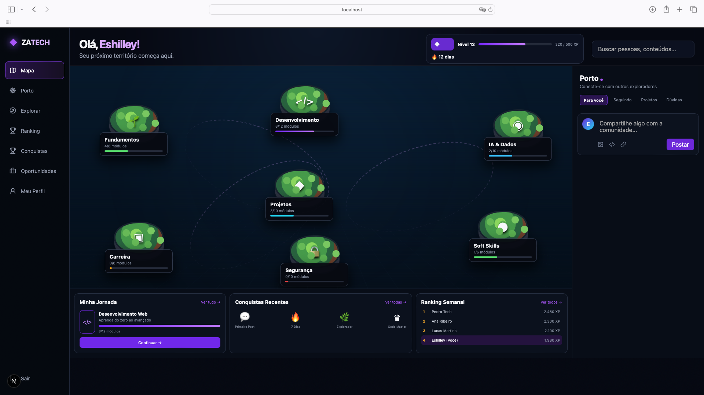

# ZATECH Platform

Plataforma gamificada de aprendizagem e comunidade para tecnologia: mapa de ilhas, trilhas, conceitos, XP, conquistas, ranking e Porto (timeline social).

## O que já está implementado
- Next.js responsivo (desktop/mobile)
- NestJS separado do frontend
- PostgreSQL + Prisma
- Sessões com cookie HttpOnly + hash do token no banco
- Password hashing com scrypt + salt aleatório
- Helmet + CORS + rate limit básico
- Feed paginado
- Criar post autenticado
- Like endpoint
- Trilhas/ilhas/módulos/conceitos
- Conclusão de módulo com XP calculado no servidor
- Ledger de XP
- Ranking
- Perfil
- Seed demo
- Docker Compose para PostgreSQL + Redis

## Rodar localmente
1. Instale Node 20+ e Docker.
2. `cp .env.example .env`
3. `docker compose up -d`
4. `npm install`
5. `cp apps/web/.env.example apps/web/.env.local`
6. `cp apps/api/.env.example apps/api/.env`
7. `npx prisma generate`
8. `npm run db:push`
9. `npm run db:seed`
10. `npm run dev`

Web: http://localhost:3000
API: http://localhost:4000

Demo: `demo@zatech.dev` / `ZatechDemo123!`
